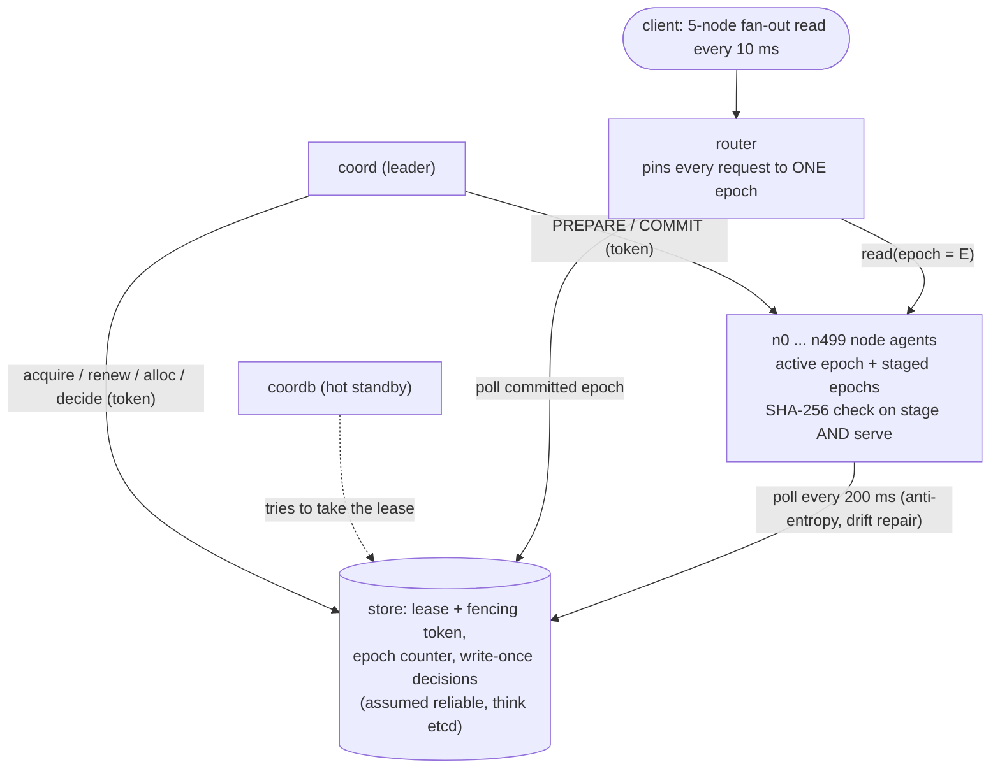
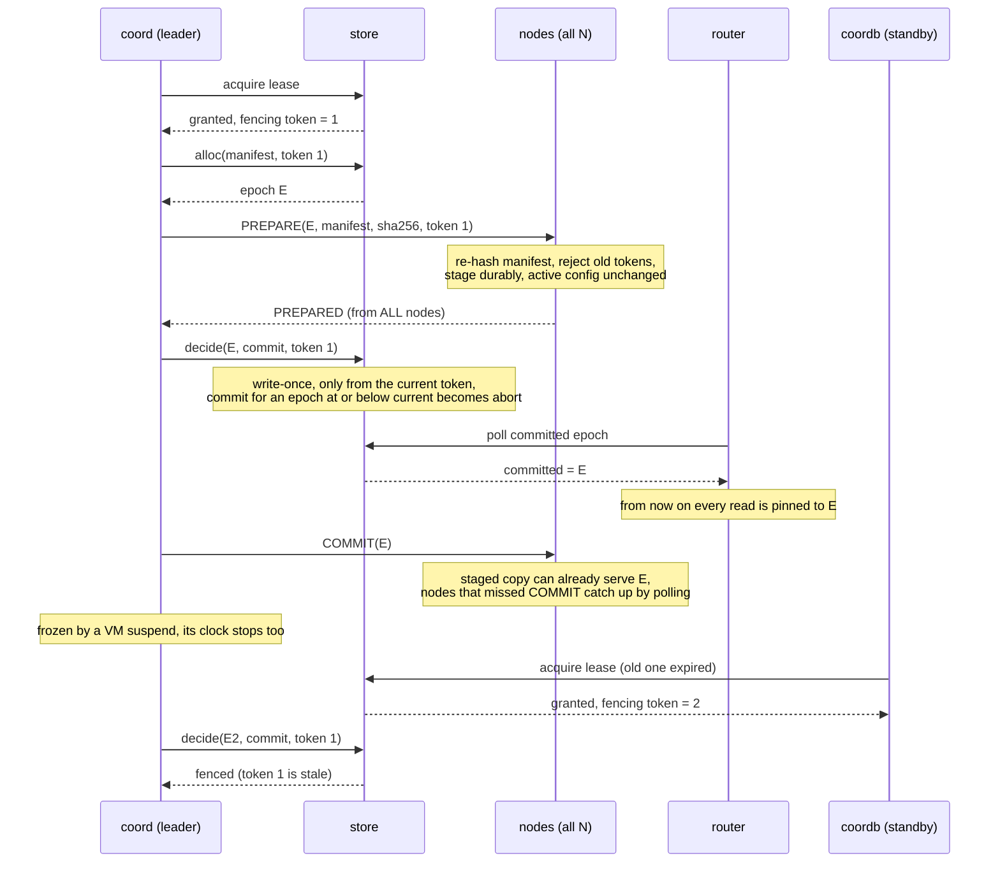
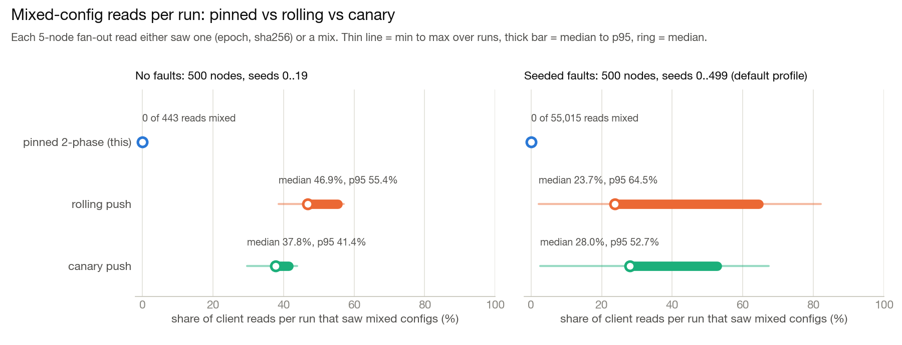
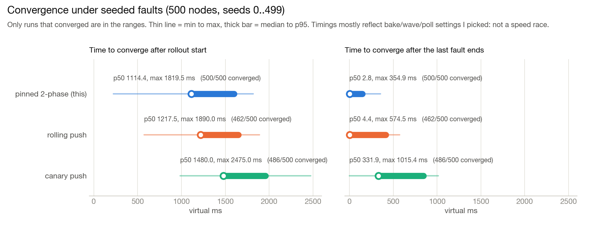
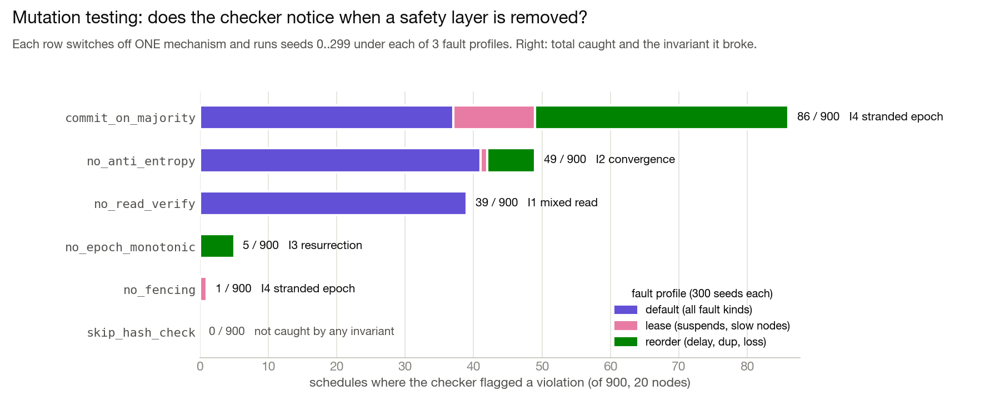

# Fleet Config Consistency

*What actually happens when half your fleet gets the new config and the other half doesn't?*

A small two-phase config rollout protocol (epochs, leases, fencing tokens, version-pinned reads),
run against thousands of seeded fault schedules on a deterministic simulator, with an invariant
checker that I then tried to fool by breaking my own code on purpose. Stdlib Python only.

### TL;DR

- **0 of 55,015** client reads saw mixed configs with the pinned protocol (500 simulated nodes,
  500 seeded fault schedules). On the *same* schedules, rolling push mixed **17,856 / 111,419**
  reads and canary push **22,152 / 91,665**.
- **0 / 500** pinned runs broke any invariant, vs **500 / 500** for both baselines. Another
  **6,000** schedules on 50 nodes across three fault profiles also gave **0** violations.
- Removing one safety layer at a time, the checker caught **5 of 6** mutations (e.g.
  `commit_on_majority` in **86 / 900** runs). It caught the missing fence in only **1 / 900**, and
  `skip_hash_check` in **0 / 900**. Both are explained below.
- The same protocol classes also ran over **real localhost TCP**: **0 / 40** fault runs with a
  violation and **0 of 4,602** reads mixed.

## Architecture



## What I built

- **A two-phase rollout protocol** (`fleetcc/protocol.py`). Store, Node, Router and Coordinator
  are I/O-free state machines (`on_message` / `on_timer`), so the *same classes* run in the
  simulator and over real sockets.
- **Leases with fencing tokens** and a hot-standby coordinator that takes over when the lease
  lapses.
- **Version-pinned reads.** The router stamps every request with one epoch; a node that
  doesn't have that epoch says `EPOCH_MISSING` instead of guessing.
- **SHA-256 everywhere.** Manifests are re-hashed before staging *and* before serving, so bit rot
  turns into a `CORRUPT` error, not a wrong answer.
- **Anti-entropy.** Nodes poll the store every 200 ms to catch up on missed COMMITs and repair
  drifted or rotted configs.
- **Two baselines** (`fleetcc/baseline.py`): a rolling push (10% of the fleet every 20 ms) and a
  canary push (5% canary, 200 ms bake).
- **A deterministic discrete-event simulator** (`fleetcc/sim.py`) with crashes, pauses,
  VM-style suspends, clock jumps, partitions, lossy links, slow nodes, corruption in transit and
  bit rot, all from a seed.
- **An invariant checker** (`fleetcc/checker.py`) that reads the full event history of each run.
- **Mutation flags + a delta-debugging shrinker** (`fleetcc/chaos.py`) that turn a failing
  schedule into a tiny replayable repro (`repros/`).
- **A real-socket mode** (`fleetcc/net.py`): every actor is an asyncio TCP server on
  127.0.0.1 with node state in JSON files.

## How it works

The question that started this: if a request fans out to five servers and two of them have
`timeout_ms=200` while three still have `timeout_ms=250`, nothing crashes. You just get quietly
inconsistent answers. A rolling deploy makes this happen on every single rollout, and a failed
rollout can leave the fleet stuck that way. So the protocol never lets the router point at an
epoch until *every* node has it staged.



A rollout of one config change, step by step:

1. **Lease.** The coordinator gets a lease from the store, which comes with a fencing token
   (1, 2, 3, ...). A hot-standby coordinator keeps trying to take it over.
2. **Allocate.** It asks the store for a new **epoch** number for the manifest.
3. **Prepare.** It sends `PREPARE(epoch, manifest, sha256, token)` to every node. A node
   re-hashes the manifest and rejects it on a mismatch. It also rejects any token older than one
   it has already seen. Otherwise it stages the manifest durably and replies `PREPARED`. Its
   active config doesn't change.
4. **Decide.** Only if **all** nodes prepare does the coordinator write `commit(epoch)` to the
   store. Each decision is write-once and only accepted from the current token. Epochs only move
   forward, so a commit for an older epoch gets turned into an abort. If prepare times out, it
   writes `abort` and retries with a new epoch.
5. **Flip.** The router polls the store and moves its pinned epoch only after the commit is in
   the store. Every client request is a 5-node fan-out, and every leg asks for *that exact
   epoch*. A node that has the epoch staged but hasn't heard COMMIT yet can still serve it,
   because it prepared it. A node that doesn't have the epoch says `EPOCH_MISSING` instead of
   guessing.
6. **Converge.** The coordinator sends COMMIT. Nodes that missed it, crashed or rotted find out
   by polling the store every 200 ms. They fetch the committed manifest, check its hash and
   activate it.

**Rollback is a new epoch.** The test plan rolls out v2 and then rolls back to the original
content as epoch 3. Epoch numbers never go down, so "rollback" can't be confused with "a stale
message about an old epoch".

**Why all nodes and not a majority?** The router can send a request to *any* node, so every node
has to be able to serve the new epoch. The `commit_on_majority` mutation below shows what
happens otherwise.

Because the protocol does no I/O itself, the same classes run on the simulator and on real
sockets. I took this idea from FoundationDB- and TigerBeetle-style simulation testing, at toy
scale.

### What gets checked

The checker reads the full event history of each run and checks four invariants:

- **I1 no mixed reads.** Every client request saw exactly one `(epoch, sha256)`, and in pinned
  mode it's the store's committed digest for that epoch.
- **I2 convergence.** After the faults stop, every node and the router end on the final
  committed config.
- **I3 no resurrection.** Store commits, router flips and every node's activations only move
  forward, and no node ever activates an epoch that wasn't committed. So a rollback can never
  resurrect an older epoch.
- **I4 no stranded epoch.** A live node never answers `EPOCH_MISSING` for the epoch that is
  the store's latest commit at that moment. If it did, the router would be routing to a config
  that part of the fleet doesn't have.

### Faults

Every fault comes from a seed:

- node crash and restart, including mid-prepare (durable state survives)
- coordinator crash
- coordinator or node pause
- **VM-style suspend:** the process is frozen *and* its clock doesn't advance, so it wakes up
  thinking its lease is still fresh
- backward clock jumps
- partitions: a slice of nodes, the coordinator, the router, or the coordinator together with
  part of the fleet
- lossy windows: drop, duplicate, reorder, delay
- delay spikes up to 600 ms
- slow nodes
- manifests corrupted in transit
- bit rot in a node's stored config

Per-message randomness comes from `hash(seed, link, seq)`, so the same seed always gives the
same history. I checked this: 20/20 seeds gave byte-identical histories, and a test also checks
it across different `PYTHONHASHSEED` values. When something fails, `shrink()` runs ddmin over
the fault list. Then it simplifies each fault and shrinks the fleet, and saves a repro you can
replay.

## Results

All numbers come from one run of `python3 run_eval.py` on an Apple M2 Mac (8 cores,
Python 3.10.8). That run took 202.3 s. Raw output is in [`results.json`](results.json), and every
chart below is drawn from that file by [`scripts/make_figures.py`](scripts/make_figures.py).

Each simulated run does two config changes (rollout, then rollback) while the router sends a
5-node fan-out read every 10 ms. Times are **virtual** milliseconds in the simulator and
wall-clock milliseconds on real sockets.

### Mixed reads: pinned vs rolling vs canary



Without any faults, rolling push mixed 528 / 1,137 reads (46.44%) and canary 724 / 1,954
(37.05%), while pinned mixed 0 / 443. That gap is just what a rolling deploy *is*, not a fault.

### 500 simulated nodes, 500 seeded fault schedules (seeds 0..499, same schedules for every mode)

| | pinned 2-phase (this) | rolling push | canary push |
|---|---|---|---|
| runs with any invariant violation | **0 / 500** | 500 / 500 | 500 / 500 |
| client reads that saw mixed configs | **0 / 55,015** | 17,856 / 111,419 | 22,152 / 91,665 |
| per-run share of mixed reads, median (p95) | 0% | 23.7% (64.5%) | 28.0% (52.7%) |
| runs that never converged (bit rot, no repair) | 0 | 38 | 14 |
| time to converge after rollout start, p50 / p99 / max | 1114.4 / 1723.0 / 1819.5 ms | 1217.5 / 1818.9 / 1890.0 ms\* | 1480.0 / 2155.0 / 2475.0 ms\* |
| time to converge after the last fault ends, p50 / p99 / max | 2.8 / 223.3 / 354.9 ms | 4.4 / 554.5 / 574.5 ms\* | 331.9 / 984.8 / 1015.4 ms\* |

\* Only over the runs that converged. Convergence times mostly come from timing parameters I
picked: the 100 ms bake between steps, the baselines' 10%-every-20-ms waves, and the 200 ms
canary bake. They aren't a speed comparison. The baselines also read for longer (non-converged
runs keep going until 15 s), so their read totals are bigger. That's why I also give the
per-run median.



In the pinned runs the faults did happen and the protocol worked around them:
- 143 prepares were aborted and retried
- the leader changed in 167 runs
- 7 stale `decide`s from an old coordinator were rejected by the fencing check
- 3,012 corrupted manifests were rejected by their hash
- 70 bit-rotted configs were repaired by polling: median 88.9 ms, max 265.5 ms after the rot,
  with a 200 ms poll interval

There were 4 reads that hit a rotted config before repair. Each one got a `CORRUPT` error
instead of being served wrong.

### Wider search: 50 nodes, 2,000 schedules per fault profile, correct protocol

| profile | runs | violations | runs with leader change | stale decides fenced |
|---|---|---|---|---|
| default (all fault kinds) | 2000 | 0 | 666 | 15 |
| `lease` (suspends aimed at prepare, slow nodes) | 2000 | 0 | 1069 | 139 |
| `reorder` (delay spikes, duplicates, loss) | 2000 | 0 | 524 | 61 |

### Did the checker actually catch anything? (mutation testing)

Zero violations is only reassuring if the checker can catch a real bug. So I added flags that
each switch off **one** safety mechanism. I ran each one on 900 schedules (20 nodes; 300 each
from the default, lease and reorder profiles) and shrank the first failure:



| mutation (one layer removed) | caught | invariant | shrunk repro |
|---|---|---|---|
| `commit_on_majority`: commit when >50% prepared | 86 / 900 | I4 stranded epoch | 4 faults -> 1, 20 nodes -> 3 |
| `no_anti_entropy`: nodes never poll the store | 49 / 900 | I2 convergence | 4 -> 1 fault, 20 -> 2 nodes |
| `no_read_verify`: serve without re-hashing | 39 / 900 | I1 mixed read | 4 -> 1 fault, 20 -> 2 nodes |
| `no_epoch_monotonic`: accept a late COMMIT for an older epoch | 5 / 900 | I3 resurrection | 5 -> 1 fault, 20 -> 2 nodes |
| `no_fencing`: store ignores stale tokens | **1 / 900** | I4 stranded epoch | 3 faults (no smaller), 20 -> 2 nodes |
| `skip_hash_check`: stage without checking SHA-256 | **0 / 900** | none | n/a |

Each shrunk repro is saved in `repros/` and replays with `python3 -m fleetcc replay repros/<name>.json`.

**The hand-written stale-coordinator scenario.** Both coordinators are suspended at t=8 ms for
600 ms and one node is slow. Over 8 seeds:

| | runs with a violation | stale decides fenced | stranded-epoch violations |
|---|---|---|---|
| fencing on | 0 / 8 | 4 | 0 |
| fencing off (`no_fencing`) | 3 / 8 | 0 | 48 |

### Real sockets: 50 node agents on localhost TCP

The same protocol classes as above, but here each node, coordinator, router and the store is an
asyncio TCP server on 127.0.0.1. Messages are length-prefixed JSON frames, and node state lives
in JSON files that a restarted node reloads. These are real wall-clock milliseconds, with 3x the
simulator's timeouts. Fault schedules are the same seeds as in the simulator.

| | pinned, clean (seeds 0..4) | pinned, faults (seeds 0..39) | rolling push, faults (seeds 0..14) |
|---|---|---|---|
| runs with any invariant violation | 0 / 5 | **0 / 40** | 15 / 15 |
| client reads that saw mixed configs | 0 / 286 | **0 / 4,602** | 546 / 2,489 (per-run median 20.5%) |
| converge after rollout start, p50 / p95 / max | 651.8 / 655.5 / 656.1 ms | 1250.9 / 1815.3 / 1890.3 ms | 1306.7 / 1785.2 / 1846.9 ms (14 of 15 converged) |
| converge after last fault ends, p50 / max | n/a | 115.6 / 694.9 ms | 306.5 / 888.1 ms |
| wall time per run, median | 0.9 s | 1.5 s | 1.5 s |

In the 40 pinned fault runs on real sockets:
- 8 prepares were aborted and retried
- the leader changed in 8 runs
- 66 corrupted manifests were rejected
- 12 bit-rot repairs happened, median 50.9 ms and max 352.2 ms
- 10 reads were refused as `CORRUPT` instead of being served wrong
- 0 handler exceptions

No stale decide was fenced in this smaller real-socket sample; that only showed up in the
simulator runs.

### What the numbers do NOT show

- **Not a speed comparison.** Convergence times are mostly my bake / wave / poll settings.
  Pinning costs a full prepare round and keeps old epochs on disk.
- **"0 mixed reads" is not "every read was fully answered".** A read counts as mixed only if the
  legs that *did* answer disagree. Under faults, 27,000 individual fan-out legs timed out in the
  pinned 500-node runs (27,726 for rolling, 28,924 for canary), mostly from partitions and
  crashes. Pinning also trades availability for safety: one unreachable node blocks the commit.
- **The fencing result is narrow.** Random search caught the missing fence 1 time in 900; the
  hand-written scenario is what really demonstrates it.
- **`skip_hash_check` scored 0.** That's a real gap in what invariants can see (see below), not
  proof the hash check is useless.
- **The fault model is mine.** Different fault ranges would change every rate here.

## What surprised me / bugs the chaos tests found in my own code

- **The protocol never failed, and that was the suspicious part.** The very first batch of
  random schedules came back with zero violations. That's not evidence of anything until you
  know the checker can fail. That's why the mutation table exists.
- **Fencing looked useless at first.** Over the first 400 schedules the store fenced exactly
  **0** stale decisions. The coordinator checks its own lease before every action, and my fault
  model had no way to make that check lie. Fencing only kicked in once I added the "VM suspend"
  fault, where the process freezes and its monotonic clock doesn't advance (Linux
  `CLOCK_MONOTONIC` doesn't count suspend). After that, a coordinator wakes up after 600 ms
  still believing its lease is fresh. That's exactly the scenario fencing tokens are for.
- **Even then, random search almost never lines it up.** `no_fencing` was caught in **1 of
  900** runs, and only in the targeted `lease` profile. It takes a stale coordinator collecting
  its last PREPARED acks right before a freeze, *and* the new leader still mid-prepare when the
  stale commit lands. So I also wrote that interleaving by hand (table above). In the shrunk
  repro you can see the store accept `commit(epoch 3)` from token 1 at t=976 ms, while token 2's
  leader is preparing epoch 4. The router flips to epoch 3, which a node had already dropped.
- **Defense in depth hides bugs from invariant checks.** `skip_hash_check` was caught 0 times.
  A corrupted manifest still gets staged. But the node re-hashes before serving, so it refuses
  with `CORRUPT`, and polling repairs the config. The bug only shows up as more `CORRUPT` errors
  (72 vs 39 in the same default-profile schedules). That's an availability cost, not a safety
  violation. I'm keeping it as an honest "0" rather than inventing an invariant just to catch it.
- **My first naive baseline looked perfect.** It pushed to all 500 nodes in parallel. With
  ~3 ms of simulated latency that finished between two reads, so it showed 0 mixed reads.
  Real deploys go out in waves, so the baselines now push 10% of the fleet every 20 ms. The
  baseline numbers depend on that pace (see the footnote above).
- **Real sockets were slower than the simulator in a dumb way.** In the first real-socket run,
  the coordinator lost its lease *during the very first rollout*. All ~55 actors share one
  Python event loop, and opening ~400 TCP connections plus writing node-state JSON files blocked it
  for more than 300 ms. Fixes: open connections up front (a fleet would already have them), and
  use 3x longer timeouts in this mode. The first warm-up version also had a bug. It waited for
  the send queues to empty instead of for the connections to finish opening, so the lag was
  still there.
- A small reporting bug: the summary said the baselines made 0 commits, because it was
  counting the store's bootstrap commit.

## Run it yourself

**Prerequisites:** Python 3.10+. The protocol, simulator, tests and evaluation use the standard
library only. Regenerating the README charts additionally needs matplotlib.

**Setup:**

```sh
git clone https://github.com/nikhils23j/fleet-configuration-consistency.git
cd fleet-configuration-consistency
```

**Quickstart** (a few seconds each):

```sh
# one seeded schedule on 50 nodes, print the timeline
python3 -m fleetcc sim --seed 42 --nodes 50 --timeline

# replay one of the saved shrunk failures
python3 -m fleetcc replay repros/commit_on_majority.json
```

**Full evaluation** (rewrites `results.json`; took 202.3 s on an 8-core M2):

```sh
python3 run_eval.py
python3 run_eval.py --quick --output quick-results.json   # smaller smoke version; without
                                                          # --output it overwrites results.json
python3 scripts/make_figures.py                           # redraw docs/img/*.png from results.json
```

### Break it yourself

```sh
# switch off a safety layer, search 300 schedules, shrink the first failure, replay it
python3 -m fleetcc chaos --runs 300 --nodes 20 --mutation commit_on_majority --shrink --out repro.json
python3 -m fleetcc replay repro.json

# the stale-coordinator hunt (try with and without --mutation no_fencing)
python3 -m fleetcc chaos --runs 900 --nodes 20 --profile lease --mutation no_fencing --shrink

# compare against the baselines on the same schedule
python3 -m fleetcc sim --seed 42 --nodes 500 --mode naive
python3 -m fleetcc sim --seed 42 --nodes 500 --mode canary

# the same thing over real TCP sockets
python3 -m fleetcc net --seed 3 --nodes 50
```

Mutations: `no_fencing`, `commit_on_majority`, `skip_hash_check`, `no_epoch_monotonic`,
`no_read_verify`, `no_anti_entropy`. Profiles: `default`, `lease`, `reorder`.

## Tests

```sh
python3 -m unittest discover -s tests -t . -v   # 31 tests, ~3 s
```

| file | what it covers |
|---|---|
| `tests/test_protocol.py` | canonical hashing; lease tokens increase and stale decides are fenced; decisions are write-once and monotonic; hash mismatch and stale tokens rejected; staged epochs serve pinned reads; activation never goes backwards; corrupted configs are not served |
| `tests/test_checker.py` | each invariant (I1 to I4) fires on a hand-made bad history and stays quiet on a clean one |
| `tests/test_sim.py` | clean rollout + rollback; same seed gives the same history, also across `PYTHONHASHSEED`; the naive baseline shows mixed reads; crash mid-prepare aborts then commits; bit rot repaired only with anti-entropy; corruption in transit rejected and retried |
| `tests/test_chaos.py` | random schedules hold all invariants; fencing blocks the stale coordinator; the majority-commit bug is caught and shrunk; ddmin finds a minimal subset |
| `tests/test_net.py` | a clean rollout over real localhost TCP; a node crash/restart reloads its state from disk |

## Project layout

```
.
├── fleetcc/
│   ├── protocol.py     Store, Node, Router, Coordinator (I/O-free state machines)
│   ├── baseline.py     rolling and canary push, for comparison
│   ├── sim.py          deterministic discrete-event simulator
│   ├── net.py          the same actors as asyncio TCP servers on 127.0.0.1
│   ├── faults.py       seeded fault schedules + per-message network model
│   ├── checker.py      invariant checker over the recorded history
│   ├── chaos.py        parallel schedule runner + delta-debugging shrinker
│   └── __main__.py     CLI: sim / chaos / replay / net
├── tests/              31 unit and integration tests
├── repros/             shrunk failing schedules, one per caught mutation
├── scripts/
│   └── make_figures.py draws docs/img/*.png from results.json
├── docs/img/           README charts
├── run_eval.py         full evaluation -> results.json
├── results.json        the numbers in this README
└── INTERVIEW_NOTES.md
```

## What this isn't / limits

- **Not a consensus system.** The store (leases, epochs, decisions) is a single in-memory actor
  that I *assume* is linearizable and never crashes. In real life that's etcd, ZooKeeper or a
  Raft group. Messages to and from it can still be dropped or delayed.
- **The router never crashes** and is a single process. If it gets partitioned it keeps serving
  the old epoch (that's safe), but I didn't model replicated routers.
- **"500 nodes" means 500 simulated actors**, not 500 machines. The real-socket mode is ~55 actors
  sharing **one** Python process and event loop on loopback, with 3x longer timeouts. Crashes
  there close sockets and reload state from JSON files. There's no fsync and no process kill.
- **Faults are my model of faults.** Network behaviour comes from a simple per-message model, not
  a real network emulator. Fault parameters are hand-picked ranges. The targeted profiles are
  biased on purpose to hit specific mechanisms.
- **The fencing result is narrow.** Random search caught the missing fence 1 time in 900, and the
  hand-written scenario is what really demonstrates it. With different fault ranges the rates
  would change.
- **Safety, not speed.** The baselines show what a rolling deploy exposes. They don't show that
  pinning is faster or cheaper. Pinning costs a full prepare round and keeps old epochs on disk,
  and it trades availability for safety: one unreachable node blocks the commit.
- No real traffic, no production use, no real configs. The manifest is a toy dict
  (`max_conns`, `timeout_ms`, `feature_x`).

## More

- [INTERVIEW_NOTES.md](INTERVIEW_NOTES.md): how it works, the design decisions and why, and
  the key results, written up for talking through the project.

I built this with AI pair-programming help (Claude). I wrote and reviewed the design, the tests
and every number here, and re-ran everything before writing it down.
